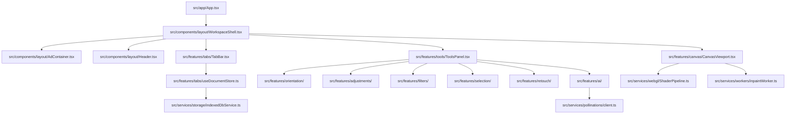

# Development Intelligence: Codebase Knowledge Graph

## 1. Overview

To maintain architectural integrity across multiple milestones and tools, EzEdit tracks component, service, and data dependencies through a structured codebase dependency graph.

---

## 2. Dependency & Flow Graph

---

## 3. Maintenance Protocol

Whenever a file or module is added or refactored:
1. Verify how the new module connects into `WorkspaceShell` or `ToolsPanel`.
2. Ensure no circular dependencies are introduced.
3. Update this diagram when component boundaries shift.
